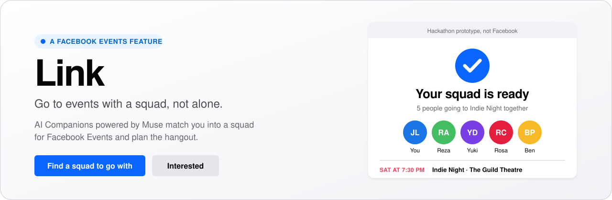
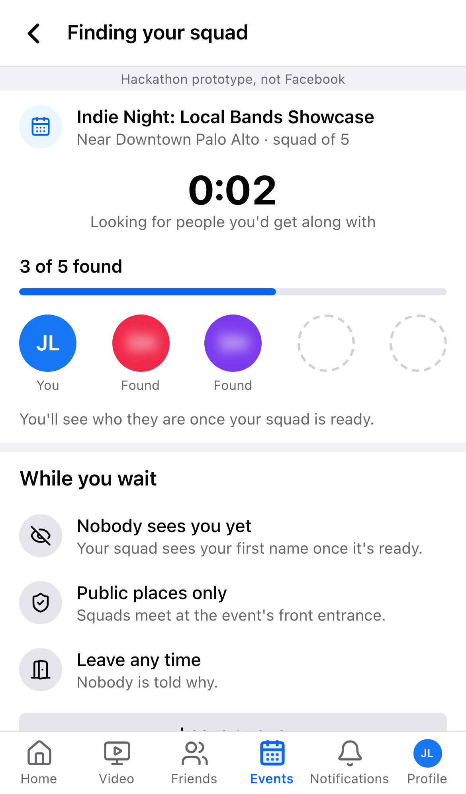
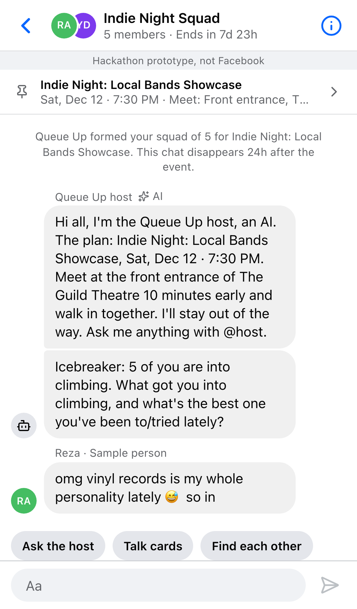
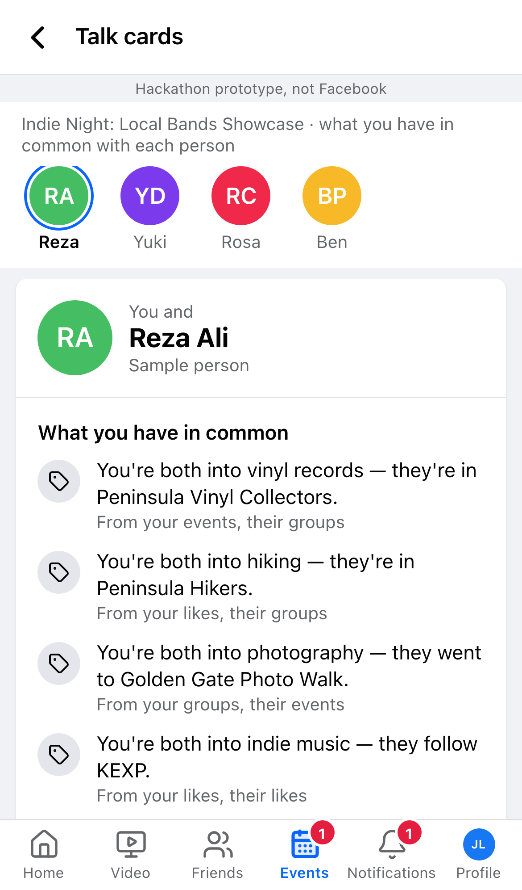
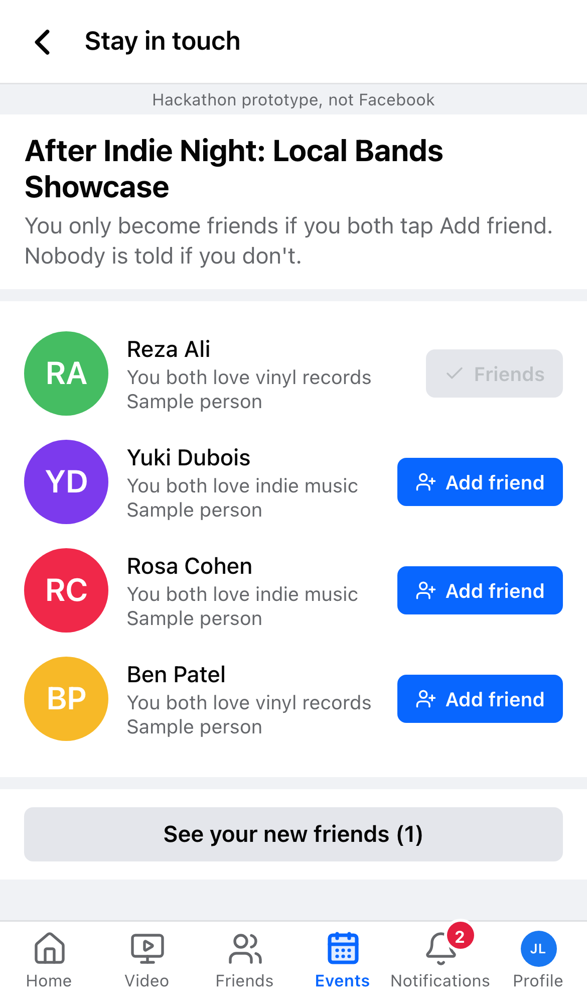
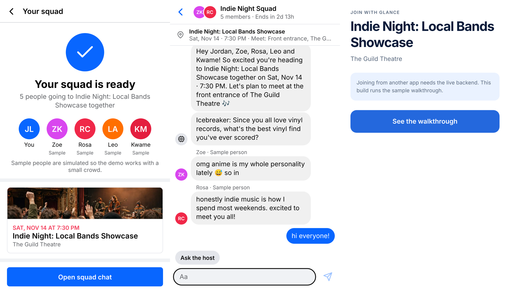
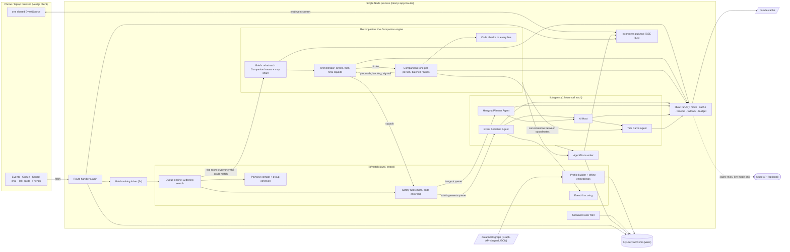

<p align="center">
  
</p>

<p align="center">
  
  
  
  
  
  
  
</p>

<p align="center">
  <a href="#quick-start"><b>Quick start</b></a> &nbsp;·&nbsp;
  <a href="#live-demo-with-judges-phones"><b>Live demo</b></a> &nbsp;·&nbsp;
  <a href="#how-a-squad-forms"><b>How a squad forms</b></a> &nbsp;·&nbsp;
  <a href="#safety-and-privacy-by-design"><b>Safety</b></a> &nbsp;·&nbsp;
  <a href="#the-mobile-app-with-glance"><b>Mobile app</b></a>
</p>

<br>

**Link** is a feature inside Facebook Events for everyone who skips an event because nobody they know is going. You queue like a ranked game, and AI Companions powered by **Muse** match you into a small **squad** of people near you who'll get along. The squad gets a short-lived chat with an **AI host**, **talk cards** to break the ice, help to **find each other** at the venue, and a way to stay friends afterwards if both people want to.

Built for Meta's *Closer Together AI Hackathon*. It's a prototype with seeded data only: no Meta logos or fonts, a "Hackathon prototype, not Facebook" label on every screen, `noindex`, and it never calls, scrapes or logs in to Facebook.

<br>

<table>
  <tr>
    <td align="center" width="20%"><br><sub><b>Slots fill like a game queue</b></sub></td>
    <td align="center" width="20%"><br><sub><b>Your squad is ready</b></sub></td>
    <td align="center" width="20%"><br><sub><b>Squad chat with an AI host</b></sub></td>
    <td align="center" width="20%"><br><sub><b>Talk cards</b></sub></td>
    <td align="center" width="20%"><br><sub><b>Stay in touch</b></sub></td>
  </tr>
</table>

---

##  &nbsp;Three ways in

Each way in runs as its own queue.

<table>
  <tr>
    <td width="33%" valign="top">
      <br>
      <b>This event</b><br>
      <sub>Start from "Find a squad to go with" on an event page. You get a squad for that event.</sub>
    </td>
    <td width="33%" valign="top">
      <br>
      <b>Any event this weekend</b><br>
      <sub>Events tab, then "Go with a squad". You get a squad, plus an existing event you'll all like.</sub>
    </td>
    <td width="33%" valign="top">
      <br>
      <b>New hangout</b><br>
      <sub>Events tab, then "Go with a squad". You get a squad, plus a brand-new hangout at a public spot near all of you, at a time you're all free.</sub>
    </td>
  </tr>
</table>

Hangout queuers only ever match other hangout queuers. Inside the existing-events queue, "any event" queuers can join someone who queued from a specific event and go to that event. Two different specific events never mix.

##  &nbsp;What happens next

<table>
  <tr>
    <td width="50%" valign="top">&nbsp;<b>Taste profile.</b> Built from your (mocked) Facebook data.</td>
    <td width="50%" valign="top">&nbsp;<b>Queue.</b> You queue with nearby people, like a ranked game queue.</td>
  </tr>
  <tr>
    <td valign="top">&nbsp;<b>Squad.</b> Your Companion helps form a compatible squad of 4 to 6 strangers (the engine supports 2 to 8). An AI agent picks the event, or plans the hangout.</td>
    <td valign="top">&nbsp;<b>Squad chat.</b> A temporary chat opens with an <b>AI host</b> who breaks the ice.</td>
  </tr>
  <tr>
    <td valign="top">&nbsp;<b>Talk cards.</b> Grounded openers for each squadmate, every claim cited.</td>
    <td valign="top">&nbsp;<b>Find each other.</b> Meet at the venue with check-ins and an opt-in "find me" photo.</td>
  </tr>
  <tr>
    <td colspan="2" valign="top">&nbsp;<b>Stay in touch.</b> After the event, add each other as friends, only if both of you say yes. The friendship is marked "Met through Link".</td>
  </tr>
</table>

---

##  &nbsp;Quick start

```bash
pnpm install                 # Node 20+, pnpm 10
cp .env.example .env         # works as-is: offline mode, no key needed
pnpm exec prisma migrate deploy
pnpm db:seed                 # 80 personas, 8 landmarks, 27 events, inbox chats
pnpm dev                     # http://localhost:3000  (you are "Jordan Lee")
```

For the demo itself, run the production build. It's faster, with no compile-on-click:

```bash
pnpm build && pnpm start     # then open http://localhost:3000/demo
```

### Muse (optional)

| env | meaning |
|---|---|
| `MODEL_API_KEY` | Muse / Meta Model API key. Leave it empty to run on cache plus deterministic fallbacks. |
| `MUSE_BASE_URL` | defaults to `https://api.meta.ai/v1` (OpenAI-compatible) |
| `MUSE_MODEL` | defaults to `muse-spark-1.1` |
| `AI_MODE` | `cache` (default: never calls out) or `live` (cache first, then Muse on a miss) |
| `AI_MAX_CALLS` | hard cap on live calls per server process (default 400; one Companion-engine room is about 45) |
| `FALLBACK_*` | optional second OpenAI-compatible provider, e.g. Llama API |

Warm the cache once with a key, so the demo replays real Muse output with no network:

```bash
MODEL_API_KEY=... pnpm ai:warm   # ~45 calls per squad (a room of 8 Companions), written to data/ai-cache/
```

### Live demo with judges' phones

1. **Open the control panel.** Go to `/demo` and pick **Live only** (or **Mixed**: real people first, then simulated fillers).
2. **Give phones a URL.**
   - **HTTPS (needed for real GPS):** run `cloudflared tunnel --url http://localhost:3000` and set `PUBLIC_URL` to the tunnel URL. The QR code on `/demo` then points there.
   - **No internet:** phones on the same Wi-Fi use `http://<laptop-ip>:3000/join`. Browsers block GPS on plain HTTP, so they pick a landmark area instead.
3. **Pick the same size.** Everyone chooses the **same party size**, for example 4 judges + you = size 5, and you'll be matched together.

### One global clock

The app runs on a single clock: real time plus a demo offset that only ever moves forward. Every stored timestamp, expiry, countdown and "x min ago" on every phone reads from it (`lib/clock.ts`). Database `@default(now())` columns are filled from it too.

- **Fast-forward: end event** advances the clock for everyone to just after the squad's event ends, and ends that event's squad chats on the spot.
- **Reset & reseed** never moves the clock back. It rebuilds the world around the clock, in the next weekend that's still ahead, so the scripted demo works again straight away.

---

##  &nbsp;The mobile app, with Glance

<p align="center">
  
</p>

[`mobile/`](mobile/) is an Expo (SDK 58) app that carries every Link screen across and has **Glance** built in. It talks to the Link server through `/api/m/*`, and its web build can be deployed to Vercel with `mobile/scripts/deploy-vercel.sh`, which forwards `/api` and `/images` to a running Link server.

<table>
  <tr>
    <td width="50%" valign="top">
      <br>
      <b>Glance</b><br>
      <sub>Meet in person and keep the conversation, not just the contact. LIVE Camera recognizes squadmates who opted in, a two-hand gesture finishes the conversation, and both people get the same Muse-written recap inside a shared chat. A separate SwiftUI client uses Ray-Ban Meta glasses as the camera.</sub>
    </td>
    <td width="50%" valign="top">
      <br>
      <b>Run it</b><br>
      <sub><code>cd mobile && npm ci && npm run web</code> starts the labelled sample walkthrough. Setup, the live backend, the iPhone app and the glasses build are in <a href="mobile/README.md">mobile/README.md</a>.</sub>
    </td>
  </tr>
</table>

---

##  &nbsp;How a squad forms

<details>
<summary><b>Architecture diagram</b></summary>



</details>

Every person in the queue gets a **Companion**, a Muse agent that knows only its own person. Companions talk to each other in small circles, propose squads, deliberate and sign off, and an **Orchestrator** forms squads from the people they chose. Code checks every line they write and re-checks every squad for safety. Then the **Event Selection Agent** or **Hangout Planner Agent** picks where to go, the **AI host** opens the squad chat, and the **Talk Cards Agent** writes the openers. Every step streams to the "How we matched you" panel.

<details>
<summary><b>The full pipeline, step by step</b></summary>

1. **The room.** Code gathers everyone in the queue who could be matched with you: same queue and event, same squad size, within the search radius, allowed by the safety rules (up to 30 people).
2. **The Companion engine decides who goes together** (`lib/companion`). Every person has a **Companion** agent that knows only its own person:
   - **Briefs.** Code builds each person's facts from their profile, with a share level per fact (share / only as a need / private). The Profile Analyst adds how the person communicates. Sensitive items never enter a brief. You choose what your Companion may share on your profile page.
   - **Circles.** The **Orchestrator** sorts the room into circles of 8–15.
   - **Vectors shortlist, Companions decide.** Two Companions only talk if their people's similarity score (profile vectors plus overlap) is at least 65%, except that everyone also talks to their closest few, so nobody is stranded.
   - **Everyone in a circle talks, taking turns.** In each pair one Companion starts (starts are spread evenly). After both introduce their person, the first asks a scenario question, the second answers and asks one back, and the first answers. Then each privately scores the other person, having heard the whole exchange. A Companion describes its person in the third person and never imitates them.
   - **Asking before saying no.** When a Companion's answer would turn down something the other side suggested, it asks its real person first: "Your Companion thinks you wouldn't be into karaoke. Would you?" (Not for me / I'd be up for it). The answer picks which line is sent, with no extra Muse call, and "up for it" is remembered. After 45 seconds the Companion's guess is sent. Simulated people are never asked.
   - **Deep dives.** Pairs where a Companion asked for more (or the two scores disagree) get one more exchange: a reaction, an honest concern, and what each person would need.
   - **Proposals and deliberation.** Each Companion proposes a squad for its person, then backs, amends or holds.
   - **Check-in with you.** After the first round, each real person's phone shows who their Companion would pick and why. They can drop people (code never puts them together) and tell their Companion what it got wrong or what they actually want (private to their Companion, remembered next time). If they don't answer within 45 seconds, the Companion goes ahead.
   - **Squads.** The Orchestrator forms squads of exactly the size you picked, only from people a Companion chose.
   - **Group conversation and sign-off.** In one round, each of the squad's Companions speaks to the group and says yes or no. A no is binding and anonymous, and the Orchestrator revises once. Then the ready check gives each real person the final call (I'm in / Not this group). Until everyone is in, nobody sees who else was queueing, and in the live view other people show up by first name, age and their own intro line, with blurred photos.

   A Companion makes one Muse call per round and speaks to everyone in that round, so a room of 8 is about 45 calls (about 37 once each person's brief is cached). Code checks every line: citations must be the speaker's own shared facts, private facts and sensitive topics are blocked, and each prompt holds exactly one person's brief.
3. **Code re-checks safety** on every squad before it is committed.
4. The next step depends on the queue:
   - **Existing-events queue:** the **Event Selection Agent** chooses from events that code has already verified. Its pick is then re-validated.
   - **Hangout queue:** code builds every option: a public spot (`data/seed/spots.json`) within 12 km of *every* member's area, a slot inside everyone's shared free time and the spot's hours, and nothing anyone dislikes. The **Hangout Planner Agent** picks one and names it, in one Muse call. Its pick is re-validated, and its text is length-capped and sensitivity-filtered. The plan is saved as a squad-only event (`Event.kind = "hangout"`), so chat, check-ins, expiry and "Met through Link" work unchanged.
5. **Ready check ("I'm in").** Every real member gets 10 minutes (`acceptWindowMs` setting) to tap **I'm in** or **Not for me**. Until everyone is in, the server shows only first name, last initial and shared interests: no photos, no rationale, no trace.
6. On the last accept, "Your squad is ready" plays, the squad chat is created and the **AI host** welcomes everyone. "How your Companions decided" shows each person their own Companion's conversations with their squadmates, and how its pick compares with ranking people by similarity.
7. The **Companions' conversations** between squadmates feed the **talk cards** and are shown on the cards screen, labeled as AI.
8. Every step is written to `AgentTrace` and streamed to the "How we matched you" panel.

</details>

<details>
<summary><b>Code map</b></summary>

| path | what |
|---|---|
| `lib/graph` | Graph API–shaped schemas, mock source, interest vocabulary |
| `lib/profile` | taste profile builder, deterministic embeddings |
| `lib/match` | compatibility, cohesion, queue engine (separate queues), safety, event fit, hangout fit, friend safety |
| `lib/companion` | the Companion engine: briefs, message checks, Orchestrator, Companion rounds, the room |
| `lib/agents` | event selection, hangout planner, AI host, talk cards (prompts + validation) |
| `lib/ai` | the single model interface |
| `lib/server` | DB services (queue, pipeline, chats, host, expiry, friending, demo) |
| `app/` | UI and API routes |
| `components/fb` | Facebook-style primitives (TopBar, TabBar, Sheet, ListRow, Bubble…) on the tokens in `app/globals.css` |
| `mobile/` | the Expo app with Glance built in (see [mobile/README.md](mobile/README.md)) |
| `tests/unit` | Vitest (`pnpm test`; includes a design-token guard) |
| `tests/e2e` | Playwright (iPhone viewport, production build, network disabled; `E2E_PORT` if 3100 is taken) |

</details>

---

##  &nbsp;How it maps to the rubric

<table>
  <tr>
    <td width="30%" valign="top">&nbsp;<b>AI integration</b></td>
    <td valign="top">A multi-agent <b>Companion engine</b> plus four single-call agents, all behind one Muse adapter. Every person has a <b>Companion</b> that talks to the others in its circle, proposes a squad, deliberates and signs off; an <b>Orchestrator</b> draws the circles and forms the squads; code checks every line and re-checks every squad. The <b>Event Selection Agent</b> picks from code-verified events, with runner-ups and reasons. The <b>AI host</b> writes a welcome plus an icebreaker grounded in a real shared interest, then replies to @mentions. The <b>Talk Cards Agent</b> writes openers from source-cited facts. The streaming <b>"How we matched you"</b> trace makes the agents' reasoning visible.</td>
  </tr>
  <tr>
    <td valign="top">&nbsp;<b>Product thinking and user impact</b></td>
    <td valign="top">Going alone is the barrier, so the squad is the product. Safety is designed in from the first screen. Party size works like a game mode. Expiring chats keep it low-pressure. Mutual-consent friending turns one night into lasting connections. "Met through Link" closes the loop inside Facebook. Live sign-up plus Live and Mixed modes show it working with real people in the room.</td>
  </tr>
  <tr>
    <td valign="top">&nbsp;<b>Execution and demo</b></td>
    <td valign="top">The <code>/demo</code> panel: one-click reset, fill modes, QR join, AI cache toggle, live queue view. The full 10-step script is an automated E2E that runs in about 30s, with the network disabled. iPhone screenshots of every screen are in <a href="docs/screens/after/"><code>docs/screens/after/</code></a> (before the Facebook-shell rework: <a href="docs/screens/before/"><code>docs/screens/before/</code></a>).</td>
  </tr>
  <tr>
    <td valign="top">&nbsp;<b>Originality and cohesion</b></td>
    <td valign="top">A game-style queue (timer, slots filling, widening search, one loud "Your squad is ready" moment) drawn in Facebook's own materials, mapped onto real-world social anxiety. It reads as native Facebook Events, Messenger and Friends. One data model runs from Graph-shaped data through to the friendship edge, with the event recorded on it.</td>
  </tr>
</table>

---

##  &nbsp;Safety and privacy by design

All of these are enforced **in code**, with property-based tests. An agent can propose; code decides.

- **Age bands.** Users only match within their own band (13–15, 16–17, 18–24, 25+), so minors and adults are never in the same squad. Search widening never relaxes this. Friend suggestions never cross the minor/adult line. *(The demo uses self-declared age at sign-up. Production would use Facebook's verified age.)*
- **Women-only option.** A woman can choose to be matched only into all-women squads. This is enforced pairwise and at party level.
- **Blocks.** Blocked users are never matched together, never suggested as friends, and can't send squad friend requests, in either direction.
- **Public venues only.** Queueing for a private-address event is refused. The event agent's pick is re-validated against `isPublicVenue`. Hangouts are only ever planned at public spots from a curated list, never someone's home.
- **Squad-only hangouts.** A planned hangout never appears in the feed, can't be RSVP'd or queued into, and its page 404s for anyone outside the squad.
- **Opt-in, party-scoped photos.** Members can add a "find me" photo that only their squad can fetch. Anyone outside the squad gets a 404. Photos are deleted when the chat ends.
- **You control your Companion.** Your profile page lists everything your Companion knows, and for each fact you choose: share, only as a need (it can ask for what you need without saying why), or keep private. Code blocks any line that repeats a private fact.
- **No one is named as the reason.** If a Companion declines a squad, the others only see that the group changed.
- **Grounded talk cards.** Every claim cites the exact field it came from, such as `p05:groups[1]` or `mutualFriends`. Claims whose sources don't resolve are stripped, and cards are re-validated again when read.
- **No sensitive inferences.** Politics, religion, health and sexuality are never used for matching and never shown. Sensitive pages are flagged at the vocabulary level, and a text filter backs that up. Tests run against a deliberately hostile mock model and planted sensitive data.
- **Minimal data to the model.** Prompts contain first names and non-sensitive interest labels only. Each Companion call holds exactly one person's brief plus what the others chose to share.
- **Location.** GPS is used only to pick a nearby landmark area, and the exact fix is never shared. Any GPS fix more than 15 km from every Link area is ignored in favor of a manual pick.
- **Mutual-consent friending.** A friendship exists only when both people tap *Add friend*. One-sided requests stay pending, and nobody is told if you don't add them.
- **Expiring chats.** Squad chats auto-archive 24h after the event and become read-only.
- **Private post-event ratings.** When a squad chat ends, each member gets a pop-up to rate the night (1–5) and, optionally, say per squadmate whether they'd squad up again. Only the rater can read their answers back. Stars tune "For you" and the event pick; "again" lifts that pair's match score; "not again" keeps the pair out of future squads (never between people who queue together). The trace says ratings were used, with no names or counts, and the agent's rationale may not mention them (`lib/match/ratings.ts`, `lib/server/ratings.ts`).
- **Real-person transparency.** AI-host messages, Companion conversations and AI-written openers are labeled as AI.

---

##  &nbsp;Testing

```bash
pnpm test        # typecheck + lint + Vitest (unit, integration, property-based)
pnpm test:e2e    # Playwright on a production build, NETWORK_DISABLED=1
pnpm test:all
```

- **Property-based tests (fast-check).** Random queues, including minors, women-only users, blocks, every party size and every fill mode, always satisfy the safety invariants. That includes when a malicious agent picks the group. Event picks are always public, inside everyone's free time, and free of anything a member dislikes.
- **E2E coverage:** every tab, feed filtering, live sign-up on two phones, GPS and manual queueing, a 3-person live party, realtime chat between two clients, squad chat with badges, host welcome, talk cards, check-ins and photo privacy, expiry, friending, the full scripted demo, and the screenshot sweep.

##  &nbsp;Synthetic data

There is no real Facebook data. `scripts/gen-personas.ts` deterministically generates 80 Graph-API-shaped personas aged 18–30 around Menlo Park, Palo Alto, Stanford and Redwood City:

- Interest clusters: indie + climbing, board games + anime, run club + coffee, hiking + photography, builders, food, plus bridge personas and two deliberate outliers.
- Friend graphs: dense within clusters, sparse across them.
- Planted sensitive likes, so the privacy filter has real data to strip.
- Seeded blocks.

`MockGraphSource` can be swapped for a real Graph API client.

<br>

<p align="center">
  <sub>Hackathon prototype, not Facebook. Built for Meta's Closer Together AI Hackathon, November 2026.<br>
  Design rules: <a href="DESIGN.md">DESIGN.md</a> · Words and voice: <a href="PRODUCT.md">PRODUCT.md</a> · Working here: <a href="AGENTS.md">AGENTS.md</a></sub>
</p>
