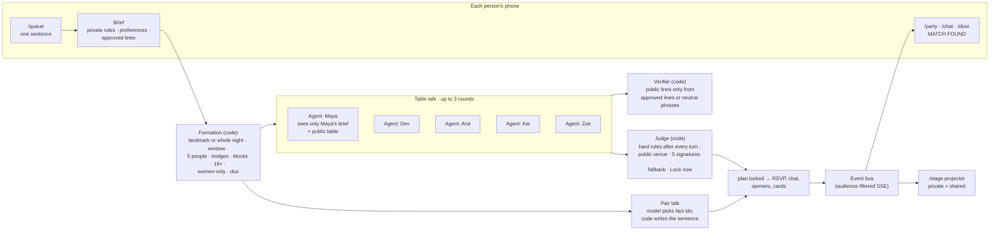
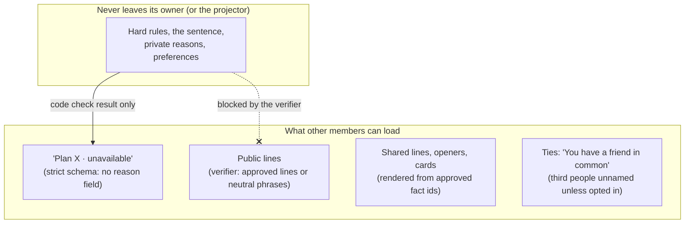

# Architecture

Party Queue is one Next.js app (App Router, TypeScript) with all state in memory and realtime
over server-sent events. Every agent turn is a separate model call; code decides everything
that matters. Hackathon prototype, not Facebook: fictional data, no login, no Meta assets.

## The whole loop

## Where privacy is enforced

| Guarantee | Enforced in | Proved by |
|---|---|---|
| A rejected plan reaches the table only as "unavailable" | `contracts/events.ts` (strict `PlanUnavailablePayload`), `lib/server/bus.ts` validates every event | `tests/unit/agents.test.ts` |
| Each browser hears only its own events | `lib/server/bus.ts` (`visibleTo`), `app/api/stream/route.ts` | `tests/unit/agents.test.ts`, `evals/run.ts` privacy suite |
| Public lines come only from approved lines or neutral phrases | `lib/agents/verifier.ts` | `tests/unit/agents.test.ts`, eval verifier suite |
| Code beats the model on hard rules | `lib/agents/judge.ts`, `lib/agents/table.ts` | eval adversarial suite |
| Every machine sentence maps to approved fact ids | `lib/agents/pair.ts` (model picks ids; code renders) | eval grounding suite |
| No third person named without opting in | `lib/agents/pair.ts` (`nameable`, `bridgeLine`), hashed bridge ids in `lib/graph.ts` | `tests/unit/bridges.test.ts` |
| "What the party knows" is computed, not claimed | `lib/server/secret.ts` scans what each other member can load | `tests/unit/secret.test.ts` (a planted leak turns it red) |
| Nothing inferred from a face | `lib/door/recognition.ts`: a matcher may only return a gallery id or null | `tests/unit/door.test.ts` |
| Reports never reach the reported person | `lib/server/safety.ts` publishes no event | `tests/unit/safety.test.ts` |

## Modules

| Path | What it does |
|---|---|
| `contracts/` | Zod schemas for every entity and the realtime event catalogue |
| `fixtures/` | 40 fictional profiles, friend graph, Groups, 15 events, the demo party, door frames, a recorded run |
| `model/` | OpenAI-compatible client (mock by default, validated, timeout, fallback, 300-call cap), runtime settings, recordings |
| `lib/agents/` | brief, agent turns, table talk (streamed), judge, verifier, pair talk, orchestrator |
| `lib/queue/` | formation rules |
| `lib/server/` | in-memory store (with async-context isolation), event bus, queue, views, door, chat lifecycle, secret, why, fair, safety, phones |
| `lib/stage/` | the board reducer behind the stage scrubber |
| `lib/evals/` | the four-way leak comparison behind `/evals` |
| `lib/flags.ts` | one flags file; every phase-2 feature is a layer behind a flag |
| `app/` | routes (see the README) and API handlers |

## Realtime

One `EventSource` per page (`components/live/LiveProvider.tsx`). The server keeps a
listener set on `globalThis`; `publish()` validates the envelope, stores it, and sends it to
every listener whose viewer is in the audience. Operator screens (`/stage`, `/demo`,
`/phones`, `/fair/host`, `/evals`) connect as observers: they never count as a phone and hear
nothing personal. The stream's hello carries the server clock so phones report MATCH FOUND lag
in server time.

## Isolation

`/evals` runs 25 parties in-process. It uses `AsyncLocalStorage` to give that run its own
store, so a request arriving meanwhile still sees the live demo, and its events never reach a
browser.
